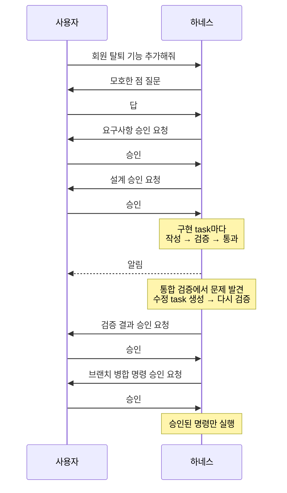

# devflow-harness

AI 에이전트에게 개발을 맡길 때 생기는 검증 누락, 규칙 우회, 검토 과부하를 줄이기 위해 만든 Claude Code 개발 하네스입니다.

일을 task 단위로 잘게 나누고, 작성은 작성 에이전트가, 판정은 검증 에이전트가, 상태와 승인과 외부 명령은 스크립트가, 뒤 작업 전체에 영향을 주는 결정은 사람이 맡도록 책임을 나눕니다. 모든 지시·결과·판정·승인을 파일로 남기고, 그 기록을 근거로 나누는 기준과 확인 절차를 실행마다 고쳐 갑니다.

## 왜 만들었나

에이전트에게 개발을 맡기면 결과는 빨리 나오지만, 그 결과를 어디까지 믿어도 되는지가 흐려집니다.

- **검증 누락**: 코드를 쓴 에이전트가 직접 테스트를 돌리고 "통과"라고 보고합니다. 하지만 몇 번 실패한 뒤 재시도로 겨우 통과한 것인지, 테스트가 애초에 아무것도 확인하지 않는 것인지는 그 보고만으로 알 수 없습니다.
- **규칙 우회**: "판정 기준을 바꾸지 말 것", "승인 없이 명령을 실행하지 말 것"을 문서로 적어 두어도, 일이 막히면 에이전트는 기준을 자기에게 유리하게 좁히거나 승인받은 것과 다른 명령을 실행합니다.
- **검토 과부하**: 그렇다고 모든 결과를 사람이 확인하게 하면 승인 요청이 끝없이 쌓입니다. 사람의 판단이 필요 없는 결과까지 승인을 묻다 보면, 정말 봐야 할 요청도 대충 넘기게 됩니다.

한 번의 검증에서 봐야 하는 양이 너무 크고, 그 검증을 누가 책임지는지 정해져 있지 않기 때문입니다. 그래서 이 하네스는 검증 한 번의 범위를 작게 줄이고, 검증의 책임을 그것을 가장 확실하게 해낼 주체에게 나눠 맡깁니다.

## 작업 모델: 블록·task·에이전트

이 하네스는 일을 세 층으로 나눠 다룹니다.

| 층 | 무엇인가 | 예 |
|---|---|---|
| 블록 | 만들어 내는 산출물의 종류입니다. 블록마다 무엇이 되어야 끝나는지(완료 기준)가 정해져 있습니다 | 요구사항, 원인 분석, 설계, 구현, 검증, 배포 |
| task | 블록 아래에서 실제로 처리하는 일 하나입니다. 검증은 늘 task 하나 단위로 합니다 | 「주문 목록 API 설계」, 「기간 필터 구현」 |
| 에이전트 | task 하나만 맡아 처리하고 끝나는 서브에이전트입니다 | 설계 작성 에이전트, 검증 에이전트 |

task가 크면 더 작게 나눠서, 한 번의 검증이 다루는 양을 작게 유지합니다. 정해진 파이프라인은 없고, 각 task는 자기가 의존하는 task가 끝나면 시작합니다. 서로 의존하지 않는 기능 묶음은 git worktree로 작업 폴더를 따로 만들어 동시에 진행합니다.

### 작성과 판정을 나눕니다

task마다 작성 에이전트가 결과를 쓰고, 검증 에이전트가 그 결과를 판정합니다. 검증 에이전트는 그 task의 작성·수정 지시·수정에 참여하지 않은 에이전트로 띄웁니다. 전체를 진행하는 메인 세션은 바뀐 파일 목록을 대조하는 것처럼 기계적인 확인만 합니다. 검증 에이전트가 무엇을 어떻게 보는지는 [설계의 핵심](#설계의-핵심)에서 설명합니다.

끝난 결과에 고칠 것이 생겨도 그 결과를 직접 고치지 않고 새 task로 만들기 때문에, 수정도 같은 검증을 거칩니다.

### 맥락은 파일로 넘깁니다

에이전트는 앞의 대화를 이어받지 않습니다. task마다 지시(범위, 입력으로 읽을 파일, 판정 기준)를 파일로 만들고, 에이전트는 그 파일이 지정한 것만 읽습니다. 결과와 판정도 파일로 남기므로, 다음 task는 앞 task의 대화가 아니라 그 파일을 이어받습니다.

## 설계의 핵심

### ① 검증 에이전트는 보고가 아니라 결과물을 직접 봅니다

작성 에이전트의 요약을 믿지 않고, 결과물을 직접 읽거나 직접 다시 실행해서 판정합니다. 검증 에이전트는 두 종류입니다.

- **읽어서 확인하는 검증 에이전트**는 문서와 코드를 직접 열어 판정 기준과 하나씩 대조합니다. 기록만 보고 확인한 기준은 통과로 세지 않고, 보지 못한 범위는 "판정불가"로 따로 밝힙니다.
- **다시 실행해서 확인하는 검증 에이전트**는 빌드와 테스트를 작성자와 따로 다시 돌립니다. 실행을 시작하기 전부터 실패하던 테스트(기준선)와 이번 변경으로 새로 생긴 실패를 구분합니다.
- **변이 확인**: 기능을 지키는 테스트에 대해, 대상 코드를 일부러 한 줄 망가뜨려 그 테스트가 실제로 실패하는지 확인합니다. 아무것도 확인하지 않는 테스트는 여기서 드러납니다.

문서 task는 읽어서 확인하는 검증을, 코드 task는 다시 실행해서 확인하는 검증을 늘 거칩니다. 코드 task에도 범위 밖 변경이나 설계와 달라진 점이 있으면 읽어서 확인하는 검증이 함께 붙습니다.

### ② 해석의 여지가 없어야 하는 일은 스크립트가 맡습니다

task의 상태 변경, 승인 기록, 저장소 밖으로 나가는 명령은 판단이 아니라 정확함만 필요한 일입니다. 에이전트에게 맡기면 해석할 여지가 생기므로, 스크립트를 거치게 하고 규칙에 어긋난 요청은 스크립트가 거부합니다.

- **`task_set.py`**: 정해진 순서에 없는 상태 변경(예: 검증 없이 완료로 넘기기)을 거부합니다. 판정 기준을 고치면 원래 기준과 고친 기준이 모두 남습니다.
- **`exec.py`**: 병합·push·배포 명령을 승인하는 순간의 내용 그대로 고정해 두고, 그 명령만 한 번 실행합니다.
- **`machine_check.py`**: 실제로 바뀐 파일을 task에 적힌 범위와 대조하고, 범위 밖 변경이 있으면 읽어서 확인하는 검증을 반드시 붙입니다.

### ③ 사람에게는 판단이 필요한 것만 하나씩 묻습니다

뒤 작업 전체에 영향을 주는 결정과 작업 폴더 밖에 반영되는 실행만 승인을 묻고, 사람의 판단이 필요 없는 결과는 알림으로 지나갑니다.

- **묻는 것**: 요구사항·설계·배포 계획처럼 뒤 작업 전체에 영향을 주는 결정, 브랜치 병합·push·PR 생성·배포처럼 저장소 밖에 반영되는 명령, 검증을 통과하지 못한 task의 처리, 사람만 확인할 수 있는 일
- **알리는 것**: 검증을 통과했고 사람의 판단도 사람이 할 일도 필요 없는 결과는 한 줄로 알립니다. 알림으로 지나간 구현은 기능 묶음이 끝날 때 통합 검증이 빠짐없이 다시 읽습니다.
- **묻는 방식**: 한 번에 task 하나만 묻고, 여러 개를 묶어 승인받지 않습니다. 코드 본문 대신 정해야 할 것과 알아 둘 것만 올립니다.

### ④ 대화가 사라져도 파일로 이어 갑니다

결정, 답, 진행 위치를 대화보다 먼저 파일에 씁니다. 그래서 `/clear`나 세션 종료 뒤에도 `/devflow-harness:devflow-harness 이어서`로 부르면 파일에서 진행 위치를 읽어 그 자리에서 이어집니다.

### ⑤ 에이전트는 자기 몫의 규칙만 읽습니다

하네스의 규칙은 한 문서에 모여 있지 않고, 누가 언제 읽는지에 따라 층으로 나뉘어 있습니다.

| 층 | 읽는 쪽 | 예 |
|---|---|---|
| 공통 계약 | 메인 세션과 모든 에이전트 | 쓰는 곳, 밖으로 나가는 명령, 우회 금지 |
| 역할 | 작성 에이전트 / 검증 에이전트 | 결과 파일을 쓰는 법, 판정하는 법 |
| task 종류 | 그 종류를 맡은 에이전트 | 설계 task의 완료 기준, 구현 task의 검증 순서 |
| 경우 | 그 경우를 만난 에이전트 | 운영 배포, 여러 환경 배포 |

메인 세션도 진입 문서 하나만 늘 읽고, 나머지 절차 문서는 그 단계에 들어설 때 읽습니다. task의 결과 본문은 읽지 않고 지시 파일과 승인 화면 재료만 봅니다. 그래서 하네스 문서 전체는 약 34만 바이트지만, 에이전트 하나가 task 하나에서 읽는 것은 그 가운데 약 8~16%입니다.

이 구조는 시험으로 유지합니다. 문서 하나의 크기, 에이전트마다 읽는 양의 상한, 에이전트 정의에 적힌 읽을 문서가 실제로 읽어야 할 문서와 맞는지를 하네스를 고칠 때마다 확인합니다.

### ⑥ 기준과 규칙은 실행 기록으로 고칩니다

동시에 진행할 기능 묶음 수나 검증 재시도 횟수 같은 값은 고정하지 않습니다. 실행마다 쓴 값과 결과를 기록해 두고, 다음 실행을 시작할 때 지난 값과 결과를 보여 준 뒤 다시 고르게 합니다.

규칙도 대부분 실제 실행에서 생긴 문제에서 나왔습니다. 예를 들어 사람의 판단이 필요 없던 결과에도 승인을 30번 묻게 된 뒤로, 그런 결과는 알림으로 넘기도록 바꿨습니다. 규칙을 고치는 것은 사람이고, 고친 이유는 [`CHANGELOG.md`](CHANGELOG.md)에 남깁니다. 지금까지의 사건과 그로 생긴 규칙은 [`references/design-summary/events-runs.md`](references/design-summary/events-runs.md)에 있습니다.

## 한 번의 실행

새 기능을 요청했을 때 사용자가 겪는 순서입니다. 굵은 글씨가 사용자가 하는 일입니다.

> **예: `devflow-harness로 회원 탈퇴 기능 추가해줘`**
>
> 1. 하네스가 먼저 모호한 점을 묻습니다. 탈퇴한 회원의 데이터를 바로 지울지, 일정 기간 보관할지 같은 것입니다. → **답합니다.**
> 2. 요구사항을 정리해 보여 줍니다. 검증 에이전트가 확인을 마친 상태이고, 사람의 판단이 필요한 것만 올라옵니다. → **승인합니다.**
> 3. 설계도 같은 방식으로 올라옵니다. → **승인합니다.**
> 4. 구현은 작은 task 여러 개로 나뉘어 진행됩니다. 각 task는 검증을 통과하면 한 줄 알림만 남깁니다. → **할 일이 없습니다.**
> 5. 기능 묶음이 끝나면 통합 검증을 합니다. 문제가 발견되면 그것을 고치는 task가 새로 생기고 같은 검증을 다시 거칩니다. → **검증 결과를 승인합니다.**
> 6. 작업한 브랜치를 원래 브랜치에 병합하거나 PR을 만드는 git 명령을, 실행될 그대로 보여 줍니다. → **승인하면 그 명령만 실행됩니다.**



다른 요청은 시작하는 곳이 다릅니다. 버그는 원인 분석부터, 동작을 바꾸지 않는 변경(리팩터링, 테스트, 문서)은 설계부터, 배포만 하는 요청은 배포 계획부터 시작합니다. 이 순서는 정해진 단계가 아니며, 결과에 따라 어느 블록의 task든 새로 생깁니다.

## 블록 목록

| 블록 | 하는 일 | 사람에게 묻는 것 |
|---|---|---|
| 질문 | 본 작업을 시작하기 전에 사용자가 정해야 할 것을 뽑습니다. 코드나 요청에서 답이 나오는 것은 묻지 않습니다 | 질문에 대한 답 |
| 요구사항 | 요청의 범위를 정하고 기능 묶음으로 나눈 뒤, 묶음마다 요구사항과 그것이 충족됐는지 확인할 동작 시나리오(Given/When/Then)를 씁니다. 기존 코드를 전제로 한 시나리오에는 근거 위치(파일:줄)를 붙입니다 | 승인 |
| 기획 | 사용자 여정과 화면 흐름, 정책·규칙·예외, 우선순위, 성공 지표를 정합니다 | 승인 |
| 원인 분석 | 버그를 실패하는 테스트로 재현하고, 가설을 하나씩 확인해 근본 원인을 증거와 함께 확정한 뒤 수정안을 냅니다. 코드는 고치지 않습니다 | 승인 |
| 설계 | 화면마다 요소·배치·상태·문구를 정하고 와이어프레임을 그립니다. 기존 코드 구조에 맞는 변경 계획과 결정 기록을 쓰고, 구현·검증 task 목록을 만듭니다 | 승인 |
| 구현 | 설계가 정한 범위의 코드와 테스트를 씁니다. 검증에서 나온 지적을 고치는 수정 task도 여기에 속합니다 | 사람의 판단이 필요할 때만 |
| 검증 | 기능 묶음이 끝난 뒤, 어느 구현 task도 혼자서는 확인할 수 없는 것을 봅니다. task 사이의 불일치를 찾고, 동작 시나리오를 따로 다시 판정하고, 알림으로 지나간 task를 다시 읽습니다. 코드는 고치지 않고, 지적은 수정 task로 넘깁니다 | 승인 |
| 마무리 | 바뀐 동작에 맞춰 문서를 고치고, 동작 시나리오 추적표와 남은 일을 정리한 뒤, 병합이나 PR 생성 명령을 준비합니다 | 명령 실행 승인 |
| 배포 | 그대로 실행할 배포 명령, 사전 조건, 배포 뒤 확인, 되돌리는 방법을 계획합니다. 승인되면 그 명령을 실행하고 배포 뒤 확인을 다시 돌립니다 | 계획 승인(= 실행 승인), 배포 결과의 유지 또는 되돌림 |

## 빠른 시작

### 필요한 것

- Claude Code
- Git
- Python 3 (`python` 명령이 PATH에 있어야 합니다)

지금까지 Windows에서 운영해 왔고, 하네스의 규칙 문서와 화면 문구는 한국어입니다.

### 설치

```text
/plugin marketplace add ikswary/devflow-harness
/plugin install devflow-harness@devflow-harness
```

설치한 뒤에는 새 세션을 엽니다. 플러그인과 진행 상황 띠는 세션을 시작할 때 불러옵니다.

### 부르기

슬래시 명령으로 부릅니다.

```text
/devflow-harness:devflow-harness 회원 탈퇴 기능 추가해줘
```

요청 앞에 하네스 이름을 붙여도 됩니다.

```text
devflow-harness로 로그인 후 빈 화면이 뜨는 버그 고쳐줘
```

세션이 끊겼거나 `/clear`를 한 뒤에는 이렇게 부르면 이어집니다.

```text
/devflow-harness:devflow-harness 이어서
```

### 첫 실행에서 묻는 것

프로젝트에서 처음 실행하면 다음을 한 번 묻고 `_workspace/devflow-harness.project.md`에 저장합니다. 다음 실행부터는 묻지 않습니다.

- 의존성 설치 명령
- 새 작업 폴더에 준비할 비밀 파일과 준비 방법
- 테스트 자료 준비 방법
- 개발 기준 브랜치
- 결과를 원래 브랜치에 넣는 방식(병합, PR 등)

그다음 프로젝트의 빌드·테스트 명령을 찾고, 지금 테스트 결과를 기준선으로 잡습니다. 실행 전부터 실패하던 테스트는 이후 검증에서 새 실패로 세지 않습니다.

## 더 읽을 것

### 구성 요소

| 에이전트 | 하는 일 |
|---|---|
| `requirements-writer` | 질문, 기획, 요구사항을 씁니다 |
| `cause-writer` | 버그를 재현하고 원인을 분석합니다 |
| `design-writer` | 화면 설계와 설계를 씁니다 |
| `code-writer` | 코드와 테스트를 쓰고, 검증에서 나온 지적을 고칩니다 |
| `verify-writer` | 기능 묶음이 끝난 뒤 통합 검증을 합니다 |
| `release-writer` | 마무리와 배포 계획, 배포 기록을 씁니다 |
| `read-judge` | 결과물을 직접 읽어서 판정합니다 |
| `run-judge` | 빌드와 테스트를 다시 실행해서 판정합니다 |

| 스크립트 | 하는 일 |
|---|---|
| `task_set.py` | task의 지시 파일을 만들고 상태를 바꿉니다. 정해진 순서에 없는 상태 변경은 거부합니다 |
| `exec.py` | 승인할 때 고정한 외부 명령만 한 번 실행합니다 |
| `machine_check.py` | 실제로 바뀐 파일을 task에 적힌 범위와 대조합니다 |
| `board.py` | 다음에 시작할 수 있는 task와 승인 대기열을 보여 줍니다 |
| `spawn_children.py` | 승인된 결과에 적힌 다음 task를 만듭니다 |
| `screen.py` | 승인 요청에 올릴 내용을 모으고, 알림으로 넘길 수 있는지 판단합니다 |
| `retry_diff.py` | 다시 검증할 때 앞 판정 뒤에 바뀐 곳을 보여 줍니다 |

전체 스크립트 목록은 [`references/main/scripts.md`](references/main/scripts.md), 진행 대시보드는 [`docs/dashboard.md`](docs/dashboard.md)에 있습니다.

### 문서 지도

| 알고 싶은 것 | 문서 |
|---|---|
| 메인 세션이 어떤 순서로 일을 진행하나 | [`skills/devflow-harness/SKILL.md`](skills/devflow-harness/SKILL.md) |
| 메인과 모든 에이전트가 지키는 약속 | [`references/core/contract.md`](references/core/contract.md) |
| 블록마다 task가 무엇을 하고 무엇으로 검증받나 | [`references/kinds/`](references/kinds/) |
| 실행 폴더와 파일의 형식 | [`references/core/formats.md`](references/core/formats.md) |
| task 종류·에이전트·상태 값의 전체 목록 | [`references/core/registry.md`](references/core/registry.md) |
| 왜 이렇게 설계했나, 무엇을 고르지 않았나 | [`references/design-summary.md`](references/design-summary.md) |
| 아직 넣지 않은 기능과 넣을 조건 | [`references/design-summary/not-included.md`](references/design-summary/not-included.md) |
