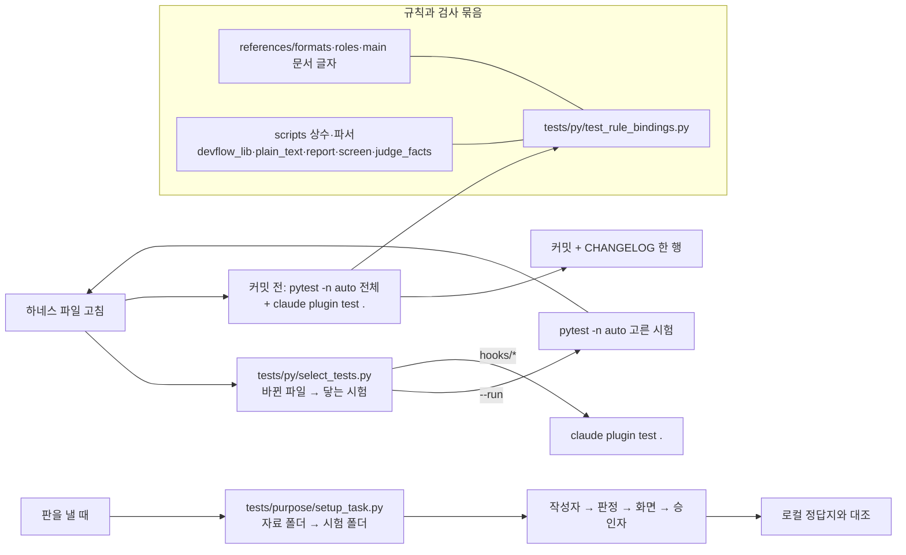

# 설계: 시험 효율화 · 규칙과 검사를 묶는 시험 · 목적 시험 이관 (흐름 `harness-tests`)

## 5. 결정 기록

| 번호 | 결정 | 버린 안 | 이유 | 종류 |
|---|---|---|---|---|
| D1 | 흐름 하나(`harness-tests`)에서 구현 여덟을 요청 차례대로 | 두 흐름으로 나눠 동시에 | 요청이 차례(4 → 2 → 1)를 정했고, 앞 행의 병렬 시험·시험 고르기를 뒤 행이 쓴다. 나누면 `CHANGELOG.md`·`docs/plugin-practices.md` 끝에서 매번 충돌한다 | 정한 것 ✔ |
| D2 | 병렬 시험은 공용 venv, `requirements-dev.txt`에 `pytest-xdist==3.8.0` | 시스템 python | T001 답 1가 | 정한 것 ◇ |
| D3 | `-n auto`는 명령에 붙이고 pytest 설정 파일을 두지 않음 | `addopts` | 시험 파일 하나를 돌릴 때도 작업자 16개를 띄우게 된다 | 정한 것 ✔ |
| D4 | 고칠 공유 상태 시험은 없다고 보고 시작하고 두 번 더 돌려 확인 | 정적 감사로 미리 고침 | 설계 때 두 번 돌려 깨짐 0(실행 기록), 정적으로도 저장소 쓰기 없음(4.1절) | 정한 것 ✔ |
| D5 | 시험 고르기는 정적 규칙 표, `tests/py/`에, 못 고른 파일은 알리기만 | coverage 기반 대응표, 못 고르면 전체 | 패키지가 늘지 않고 결정적이다. 커밋 전 전체 시험이 빠진 것을 잡는다 | 알릴 것(질문 2) |
| D6 | 고른 시험은 고치는 동안에만, 커밋 전에는 전체 | 고른 시험으로 커밋 | T001 정한 것 그대로, 원칙 문서 4절(`docs/plugin-practices.md:38`) | 정한 것 ✔ |
| D7 | 관문 훅 셋의 `.catch` 처리(4.3절 표) | `.catch`에서 그냥 `next(e)`만 | 실패가 남아야 고치기 전 코드에서 실패하는 시험을 쓸 수 있고 사람이 실패를 본다 | 알릴 것(질문 2) |
| D8 | 항목 번호는 `item_key` 하나가 머리에서만, 4.4절 꼴 표 | 지금처럼 설명 속 번호까지 | 1.3.0 목적 시험의 결함 둘이 설명 속 번호를 읽은 것이었다(`CHANGELOG.md:32`, `:34`) | 알릴 것(질문 2) |
| D9 | 이름이 아닌 꼴을 표 하나로, 호스트 이름은 마디 꼴로도. 끝 마디 목록은 지금 일곱 개 그대로 | 끝 마디 목록만 늘림, 목록도 넓힘(`app`·`info`·`me`·`dev`·`us`·`co` 등) | 목록만 늘리면 같은 갈래가 다시 나온다(원칙 문서 6절 「피드백 일반화」). 목록을 넓히면 `logger.info`, `req.app` 같은 코드 이름까지 사실 파일에서 빠진다(T002 답 1가) | 정한 것 ✔, 끝 마디 목록은 ◇ T002 1가 |
| D10 | 판정 쪽 묶음 시험은 시험만 더하고 판정 파일 규칙 문서는 고치지 않음 | 문서도 손봄 | 고치면 def-version을 올려야 하고(`references/main/maintain.md:3`), 지금 같은 값이다 | 정한 것 ✔ |
| D11 | 글자 예산·선택지 자리를 작성자가 읽는 문서(`screen-cells.md`, `result-file.md`)에 적음 | 상수에서 문장을 만듦 | 원칙 문서 2절. 작성자가 읽는 곳에 없어서 1.3.0 목적 시험에서 부딪혔다 | 정한 것 ✔ |
| D12 | 전제 셋 이내를 검사로(넘으면 꼴 경고, 알림 막음) | 문서에만 둠 | 반드시 지킬 규칙은 장치로(원칙 문서 1절 6) | 알릴 것(질문 2) |
| D13 | 목적 시험은 `tests/purpose/`, 자료·정답지는 경로 인자, 표지 파일로만 지움 | 저장소에 자료 둠, 확인 없이 지움 | T001 정한 것(전체 pytest가 모으지 않음, 정답지는 로컬), 자료 약 160MB | 정한 것 ✔ |
| D14 | 2회차 배치만 옮김 | 1회차 평면 배치도 | 1회차는 앞 실행 결정을 못 읽어 비교 무효 | 정한 것 ✔ |
| D15 | 원래 run.md를 메인이 자료 폴더에 `source-run.md`로 복사 | 스크립트가 다른 프로젝트 폴더를 읽음 | 자료가 한 폴더로 닫히고 저장소에 다른 프로젝트 경로가 들지 않는다 | 알릴 것 [해석](질문 6) |
| D16 | 지시문 틀에 정답지를 넣지 않고 시험이 낱말로 지킴 | 문서로만 | T001 정한 것, 원칙 문서 4절 "지시문에 사후 지식을 넣지 않는다" | 정한 것 ✔ |
| D17 | 판을 올리지 않음: 판본·def-version 그대로, `CHANGELOG.md`에는 `1.3.0(이어서)` 꼴 행, 목적 시험은 돌리지 않음 | 1.3.1 | T001 답 4나 | 정한 것 ◇ |
| D18 | 옛 판정 파일 꼴은 다른 프로젝트 실행 폴더의 실제 파일을 읽기만 하고 꼴만 표본으로 | 저장소 표본만 | T001 답 3가 | 정한 것 ◇ |
| D19 | 이번 실행에서는 배포하지 않는다 | — | T001 답 4나(main에 합치기만) | 정한 것 ◇ |
| D20 | 흐름이 하나라 전체 검증 행을 두지 않음 | — | `references/kinds/design/run-wide.md` 「정본에 쓰는 것」 넷째 줄 | 관례 |
| D21 | 변경마다 `CHANGELOG.md`에 한 행 | — | `CHANGELOG.md:3`, `references/main/maintain.md:6-7`, 판 없는 행의 앞선 예 `CHANGELOG.md:36` | 관례 |
| D22 | 시험 명령과 시험 고르기를 `maintain.md`와 원칙 문서 4절에 함께 적음 | — | `docs/plugin-practices.md:7` "원칙을 바꾸면 이 문서, maintain.md, 시험을 한 묶음으로" | 관례 |

## 7. 제안 도면
### 제안 도면: 기능 흐름도

